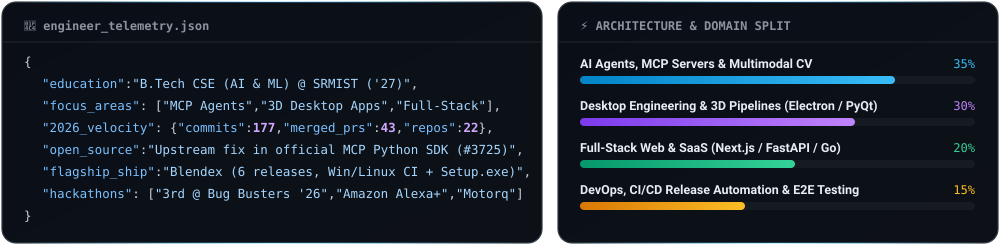

<!-- CUSTOM ANIMATED HERO BANNER -->

 

<!-- DYNAMIC TYPING SUBTITLE -->

 

<!-- SOCIAL & CONTACT PILLS -->

  
  
  
  

---

### ⚡ Engineering Telemetry & Profile Spec

  

---

### 🚀 Flagship Systems & Production Shipments

<table>
  <tr>
    <td width="50%" valign="top">
      <h3 align="left">🎨 <a href="https://github.com/g-s-jithesh/blendex">Blendex</a> — Local 3D Asset Manager</h3>
      

        
        
        
      

      
<b>Zero-cloud desktop 3D asset manager for Windows & Linux</b> that indexes <code>.blend</code>, <code>.fbx</code>, <code>.obj</code>, <code>.ma/.mb</code>, <code>.glb</code>, and <code>.usd</code> libraries with instant thumbnails and <b>hover-to-orbit Three.js 3D previews</b>.

      <ul>
        <li><b>One-Click Bridge Plug-ins:</b> Drag-and-drop or import directly into an active <b>Blender</b> or <b>Maya</b> session.</li>
        <li><b>Production Engineering:</b> Shipped <b>6 releases</b> across 25 merged PRs with automated Windows installer (<code>Setup.exe</code>) pipelines, paged large-library loading, and untrusted scene guards.</li>
      </ul>
      
<code>Python</code> <code>TypeScript</code> <code>Three.js</code> <code>GitHub Actions</code>

    </td>
    <td width="50%" valign="top">
      <h3 align="left">🎙️ <a href="https://github.com/g-s-jithesh/encore">Encore</a> — Voice Study Coach for Alexa+</h3>
      

        
        
        
      

      
<b>MCP-powered voice study coach</b> that transforms raw notes, PDFs, and lecture transcripts into LLM-generated flashcards and quizzes you by voice on a persistent <b>spaced-repetition schedule</b>.

      <ul>
        <li><b>Resilient Agent Loop:</b> Engineered the MCP-client agent loop supporting <b>Google Gemini</b> & <b>Amazon Bedrock</b> with automatic self-healing retry logic for malformed model outputs.</li>
        <li><b>Full Test Pyramid:</b> Backed by unit, integration, and automated <b>Playwright</b> end-to-end tests in CI.</li>
      </ul>
      
<code>Python</code> <code>Model Context Protocol</code> <code>Gemini</code> <code>Bedrock</code> <code>Playwright</code>

    </td>
  </tr>
  <tr>
    <td width="50%" valign="top">
      <h3 align="left">👁️ <a href="https://github.com/g-s-jithesh/omni-sight">Omni-Sight</a> — Real-Time Desktop AI Copilot</h3>
      

        
        
      

      
<b>Autonomous desktop vision copilot</b> that detects meaningful structural shifts on screen (terminal tracebacks, live telemetry, UI states) without manual screenshots.

      <ul>
        <li><b>10 FPS Producer-Consumer Pipeline:</b> Uses asynchronous <code>mss</code> frame capture + OpenCV grayscale frame-diffing (<code>absdiff</code>) for zero CPU/GPU stutter.</li>
        <li><b>Rate-Limit Aware Debouncer:</b> Dynamically throttles multimodal <b>Gemini Flash</b> calls and renders contextual insights onto a transparent, click-through <b>PyQt6 HUD</b>.</li>
      </ul>
      
<code>Python</code> <code>OpenCV</code> <code>PyQt6</code> <code>Gemini Vision</code>

    </td>
    <td width="50%" valign="top">
      <h3 align="left">⚡ <a href="https://github.com/g-s-jithesh/Amazing-Coders">Project Kilowatt</a> — EV Fleet Intelligence</h3>
      

        
        
      

      
<b>End-to-end EV fleet battery health & intelligent charging dispatch platform</b> engineered for the Motorq Connected Vehicle Intelligence Hackathon.

      <ul>
        <li><b>High-Throughput Telemetry:</b> Simulates 100K vehicles across 3 OEM schemas with real-time fault injection, DTC decoding, and battery safety alerts.</li>
        <li><b>ML & Optimization:</b> Combines State-of-Health (SoH) & 7-day fault risk ML models with a health-aware depot charging optimizer.</li>
      </ul>
      
<code>Go</code> <code>Python</code> <code>Docker</code> <code>ScyllaDB</code> <code>Machine Learning</code>

    </td>
  </tr>
  <tr>
    <td width="50%" valign="top">
      <h3 align="left">✍️ <a href="https://github.com/g-s-jithesh/manage-linkedin">Manage LinkedIn</a> — AI Post Studio</h3>
      

        
        
      

      
<b>Full-stack & desktop LinkedIn publishing suite</b> with OAuth 2.0 integration that drafts posts via LLM, remixes existing posts from URLs, and publishes directly with multi-image/video attachments.

      <ul>
        <li>Includes <b>3 humanizer modes</b>, API rate limiting, and a standalone Windows desktop installer wrapping the Next.js server in <b>Electron</b>.</li>
      </ul>
      
<code>Next.js</code> <code>TypeScript</code> <code>Electron</code> <code>Tailwind CSS</code> <code>Groq</code>

    </td>
    <td width="50%" valign="top">
      <h3 align="left">🛡️ <a href="https://github.com/g-s-jithesh/guidewire-hackathon">Kavach AI</a> & <a href="https://github.com/g-s-jithesh/Blockchain-Enabled-Federated-AI-Framework">Federated AI</a></h3>
      

        
        
      

      
<b>Applied AI for Social & Enterprise Resilience:</b>

      <ul>
        <li><b>Kavach AI:</b> Zero-touch parametric income protection for gig workers triggered by 6 live environmental signals (Wet-Bulb Heat Stress Index, rainfall, AQI, outages) + GPS fraud verification.</li>
        <li><b>Federated Threat Intelligence:</b> Privacy-preserving intrusion detection across Hospital/Bank/IoT silos using <b>DP-SGD</b> and permissioned smart contracts on CICIDS2017.</li>
      </ul>
      
<code>FastAPI</code> <code>PyTorch</code> <code>Differential Privacy</code> <code>Smart Contracts</code>

    </td>
  </tr>
</table>

---

### 🧩 Open Source & Upstream Contributions

> **[`modelcontextprotocol/python-sdk` — Issue & Fix #3725](https://github.com/modelcontextprotocol/python-sdk)**  
> Diagnosed and reported a subtle serialization bug in the official **Model Context Protocol (MCP) Python SDK** where bare `dict`, `list`, and `tuple` return annotations silently dropped structured tool output—fixed upstream in the official SDK.

- **G-SQL (Natural Language to SQL Engine):** Architected a schema-aware NL-to-SQL pipeline translating plain-English queries into complex relational joins via semantic tagging, schema linking, and graph-based join inference (`Python`, `FastAPI`, `React`).
- **Awards & Honors:** 🏆 **3rd Place — Bug Busters '26** (CINTEL, SRM Institute of Science and Technology).

---

### 🛠️ Technical Arsenal

| Layer | Technologies & Tools |
| :--- | :--- |
| **Languages** |       |
| **AI, Agents & CV** |       |
| **Frontend, Desktop & 3D** |       |
| **Backend & DevOps** |       |

---

### 📊 GitHub Analytics & Contribution Velocity

  
  

  

<!-- Animated Contribution Snake (Auto-generated via GitHub Actions on the output branch) -->

  <picture>
    <source media="(prefers-color-scheme: dark)" srcset="https://raw.githubusercontent.com/g-s-jithesh/g-s-jithesh/output/github-contribution-grid-snake-dark.svg" />
    <source media="(prefers-color-scheme: light)" srcset="https://raw.githubusercontent.com/g-s-jithesh/g-s-jithesh/output/github-contribution-grid-snake.svg" />
    
  </picture>

---

  ⚡ Crafted with custom SVG telemetry & automated workflows by <b>Gopalan Srinivasan Jithesh</b> · <a href="mailto:gsjithesh2006@gmail.com">Let's build something impactful →</a>

